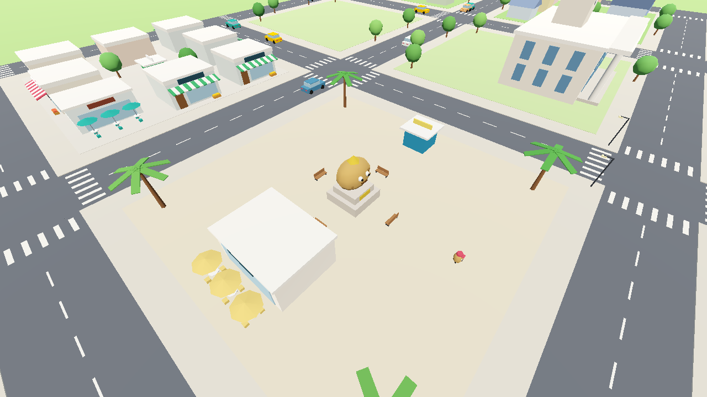
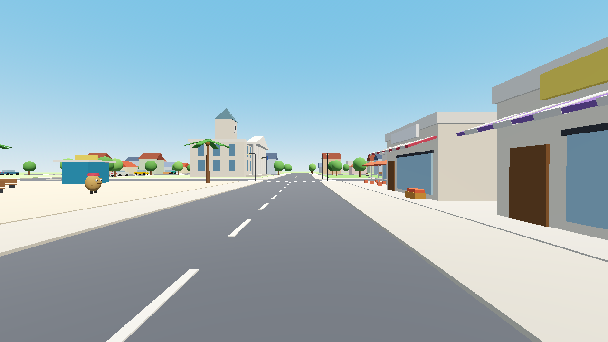
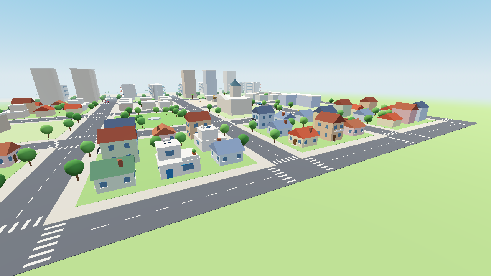
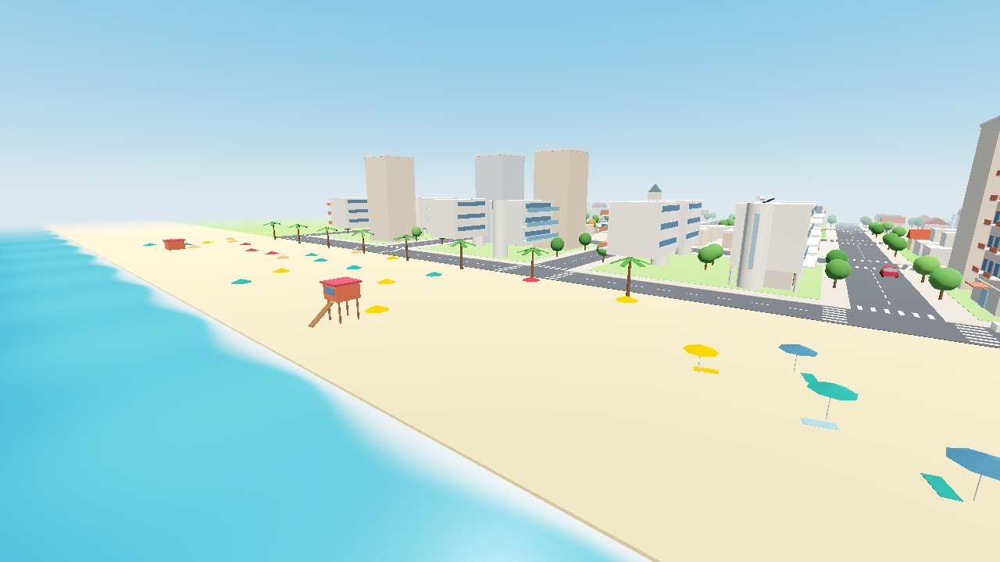

# תל בטטה – עיר מיניאטורית תלת־ממדית 🥔

משחק עיר תלת־ממדי קליל ב־**Godot 4.3** עם **Compatibility Renderer** (OpenGL 3.3), שנבנה במיוחד למחשבים חלשים.
סגנון מיניאטורי וצבעוני: חוף ים, בנייני באוהאוס, שוק, כיכר עם פסל הבטטה, שכונות בתים, מכוניות נוסעות ודמות־בטטה שמסתובבת בעיר.

| | |
|---|---|
|  |  |
|  |  |

## הרצה

1. הורידו את **Godot 4.3** (או גרסה חדשה יותר מסדרת 4.x) מ־https://godotengine.org/download – הגרסה הרגילה, לא .NET.
2. פתחו את Godot ← **Import** ← בחרו את הקובץ `project.godot` שבתיקייה הזאת.
3. לחצו על ▶ (F5). זהו.

ההגדרה הראשונית היא **איכות נמוכה** (מתאים למחשב חלש). F2 מחליף איכות, F4 מריץ בדיקת ביצועים.

## מקשים

**הליכה** – WASD תזוזה · Shift ריצה · רווח קפיצה · עכבר סיבוב מצלמה · גלגלת זום
**משחק** – E לדבר / להיכנס לבניין / לנהוג · F או קליק שמאלי בגט ספוגי · I תיק · Tab יומן משימות · Esc סגירת חלון
**נהיגה** – W/S גז ורוורס · A/D היגוי · רווח בלם יד · Q צופר · E יציאה מהרכב
**כללי** – C מצלמה חופשית · B מצב בנייה · P מצב צילום · H הסתרת עזרה · Esc שחרור העכבר
F2 איכות גרפיקה · F3 נתוני ביצועים · F4 בדיקת ביצועים · F5 שמירה · F11 מסך מלא · F12 צילום מסך

**מצב בנייה (B)** – קליק שמאלי בונה · Z/X סוג בניין · V צבע · R סיבוב · Delete מוחק את הבניין המסומן באדום · Ctrl+Z ביטול · קליק ימני וגרירה מסובב מצלמה

**מצב צילום (P)** – הממשק נעלם והמצלמה זזה בתנועה חלקה
K הוספת נקודת מסלול · Enter הפעלת המסלול (תנועת מצלמה חלקה בין הנקודות) · Backspace מחיקת המסלול
O סיבוב סביב הנקודה שמסתכלים עליה · T אפקט מיניאטורה (טילט־שיפט) · G פסים קולנועיים
[ ] שעה ביום · Z/X זום · N/M הטיית מצלמה · J איפוס · -/= מהירות המסלול · F12 צילום

### הקלטת סרטון
אפשר להקליט עם OBS תוך כדי מצב צילום. במחשב חלש עדיף להשתמש ב־**Movie Maker** של Godot, שמרנדר כל פריים בלי לחץ זמן ולכן הסרטון חלק גם כשהמחשב איטי:
ב־Godot: Project ← Project Settings ← Editor ← Movie Writer, הגדירו קובץ (למשל `video.avi`) ו־FPS 30, ואז הריצו עם כפתור ה"קלאקט" (Movie Maker) למעלה. מסלול המצלמה (K / Enter) נשמר בין הרצות.

## איך זה בנוי בשביל מחשב חלש

- **טעינה לפי אזורים** – העיר מחולקת לריבועים (chunks) של 64 מ'. נטענים רק הריבועים שסביב המצלמה, ריבוע אחד לכל פריים כדי שלא יהיו קפיצות.
- **שימוש חוזר במודלים** – כל סוג בניין נבנה פעם אחת, וכל העותקים שלו מצוירים יחד ב־MultiMesh (קריאת ציור אחת לכולם). כל העיר משתמשת בחומר (material) אחד, בלי טקסטורות.
- **LOD** – מקרוב רואים את כל הפרטים; מרחוק כל ריבוע הופך למודל פשוט אחד ממוזג (גוף הבניין והגג בלבד, עצים פשוטים). פרטים קטנים (ספסלים, פנסים) נעלמים במרחק.
- **הגבלת צללים ואובייקטים רחוקים** – באיכות נמוכה ובינונית אין צללים בזמן אמת; בגבוהה יש צל שמש אחד מוגבל למרחק. ערפל עומק מסתיר את גבול הציור.
- **התאמה אוטומטית** – אם ה־FPS יורד מתחת ל־24 לאורך זמן, האיכות יורדת דרגה לבד.

במבחן שנעשה על **מעבד בלבד, בלי כרטיס מסך** (רינדור תוכנה), הגרסה הזו רצה בממוצע ב־35 FPS עם כ־40–60 קריאות ציור לפריים. כמעט כל מחשב עם כרטיס מסך מובנה אמור להיות מהיר מזה. אחרי F4 התוצאה נשמרת בקובץ `benchmark.txt` (ראו למטה איפה), וכדאי לשלוח לי אותה.

## הקבצים של העיר

| קובץ | מה יש בו |
|---|---|
| `data/city.json` | העיר עצמה: שכונות, בלוקים, כבישים, וכל בניין עם **מזהה ייחודי** (למשל `b_00042`), סוג, מיקום, סיבוב וצבע |
| `data/building_types.json` | קטלוג סוגי הבניינים – כל בניין מוגדר כרשימת צורות פשוטות, כך שמוסיפים סוג חדש בלי לכתוב קוד |
| `tools/city_tool.py` | הכלי שמעדכן את `city.json` בבטחה (משתמש בו כשאתם מבקשים "תבנה שכונה...") |

**שמירה אוטומטית:** מה שבונים או מוחקים בתוך המשחק נשמר בנפרד, בקובץ `city_overlay.json` (כל 30 שניות, ב־F5 וביציאה), יחד עם מיקום הדמות. השינויים שלכם נשמרים בנפרד מהעיר הבסיסית, ולכן כשאני מוסיף שכונה ל־`city.json` שום דבר שבניתם לא נמחק.
מיקום הקבצים ב־Windows: `%APPDATA%\TelBatata\` (שמירה, צילומי מסך, `benchmark.txt`).

פירוט מלא של הפורמט: [docs/CITY_DATA.md](docs/CITY_DATA.md).

## לבקש שינויים בשפה טבעית

אפשר לכתוב לי למשל:
- "תבנה שכונה חדשה עם 50 בתים בצד המזרחי"
- "תוסיף שכונת מגדלים עם 2 בלוקים של בנייני מגורים ומרכז מסחרי"
- "תוסיף בית ספר וספרייה בצפון"
- "תמחק את השכונה 'גבעת הפירה'"
- "תוסיף סוג בניין חדש: תחנת כיבוי אש אדומה"

אני מעדכן את קובצי העיר עם הכלי. הכלי לא משנה ולא מוחק שום דבר קיים: הוא בונה רק על קרקע פנויה, נותן מזהים חדשים, בודק שאין חפיפות ושומר גיבוי לפני כל שינוי. אחרי כל שינוי אני גם מריץ את המשחק, מוודא שאין שגיאות ומצלם תמונות לבדיקה.

רוצים שמה שבניתם במשחק יהפוך לחלק קבוע מהעיר? שלחו לי את `city_overlay.json`, ואכניס אותו לעיר הבסיסית עם הפקודה `import-overlay`.

## הסיפור והמשחק

**"תל בטטה: הסוד של רמת פריקסה"** – 12 פרקים (`data/story.json`). טוטו הבטטה עובר לגור ברמת פריקסה,
מגלה אגדה בת מאה שנה, רודף אחרי עגבניות שגנבו את כתר הבטטה הזהובה, ומנצח (ברכות!) את מר ריקבון.
- **מטרה** – חלון המשימה למעלה וחץ/יהלום צהוב שמראים לאן ללכת.
- **קרבות רכים** – בגט ספוגי נגד עגבניות שהופכות לקונפטי. כשהלבבות נגמרים טוטו רק "מתעלף לרגע" וחוזר.
- **אתגרים** – 12 צ'יפסים זהובים מוחבאים בעיר, מרוץ משלוחים (טבעת ליד המאפייה), זירת עגבניות (גן המשחקים ברמת פריקסה), אוסף כובעים.
- **בניינים** – אפשר להיכנס לבתים, חנויות, מאפייה, משטרה, עירייה, ספרייה, בית ספר והסדנה של פריקסה. בחנויות קונים אוכל (מחזיר לבבות), כובעים ושטויות.
- **רכבים** – 10 מכוניות חונות (אחת משטרתית) שאפשר לנהוג בהן.
- ההתקדמות נשמרת אוטומטית ב־`user://progress.json`.

## הרחבה בהמשך

- **מכוניות** – כבר יש: מערכת תנועה פשוטה (`scripts/systems/traffic_system.gd`) שנוסעת על רשת הכבישים מתוך `city.json`.
- **תושבים, כלכלה, משימות** – כל מערכת היא קובץ שיורש מ־`scripts/systems/city_system.gd` ונרשם ברשימת `SYSTEMS` ב־`scripts/main.gd`. המערכת מקבלת גישה לכבישים, לבניינים ולשכונות דרך `CityData`.

## למפתחים

```
scenes/main.tscn              סצנה ראשית (הכול נבנה בקוד)
scripts/main.gd               מחבר את כל החלקים, תאורה ושעה ביום, בדיקות אוטומטיות
scripts/autoload/city_data.gd נתוני העיר, אינדקס לפי chunks, שמירה וטעינה
scripts/autoload/settings.gd  רמות איכות ומקשים
scripts/city/                 קטלוג הבניינים, כבישים ומדרכות, טעינת chunks
scripts/player, camera, ui, modes, systems
tools/city_tool.py            עריכת העיר מהטרמינל
```

בדיקות (אפשר להריץ גם בלי מסך):
```
godot --headless --path . -- --smoke                 # בדיקה עצמית: טוען הכול, בונה, מוחק, שומר
godot --path . -- --shots --quality=low              # מצלם 6 זוויות קבועות ל-user://shots (--with-ui עם הממשק)
godot --path . -- --test-story                       # משחק את כל 12 הפרקים אוטומטית
godot --path . -- --test-interiors                   # נכנס לכל סוג בניין ומצלם ל-user://shots_B
godot --path . -- --benchmark --quality=medium       # בדיקת FPS ויציאה
python3 tools/city_tool.py validate                  # מזהים כפולים / חפיפות / סוגים לא מוכרים
```
